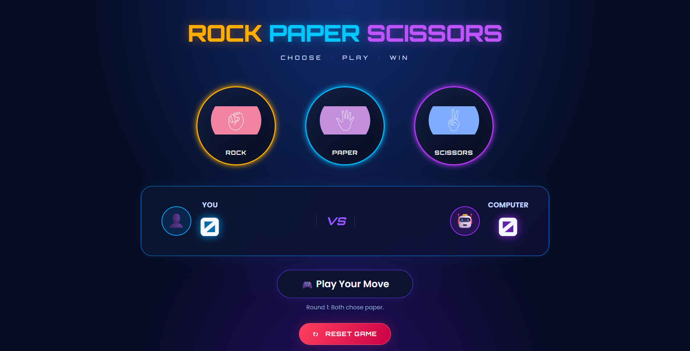

# 🎮 Neon Rock Paper Scissors

A modern, neon-themed **Rock Paper Scissors** game built with HTML, CSS, and JavaScript. Challenge the computer, track your score, and enjoy a stylish gaming interface with glowing effects and smooth animations.

## ✨ Features

- 🎨 Neon-inspired dark gaming interface
- ✊ Rock, 📄 Paper, and ✂️ Scissors gameplay
- 🤖 Random computer opponent
- 🏆 Live score tracking
- 🎯 Dynamic win, lose, and draw messages
- ✨ Glowing hover effects and score animations
- 📱 Responsive layout for mobile and desktop
- 🔄 Reset button to restart the game
- ♿ Accessible labels and keyboard focus styles

## 🛠️ Technologies Used

- **HTML5** — Page structure
- **CSS3** — Styling, responsive design, glowing effects, and animations
- **JavaScript (Vanilla JS)** — Game logic, random choices, and score management

## 📂 Project Structure

```text
Rock-Paper-Scissors/
│
├── index.html
├── RockPaperScissors.css
├── RockPaperScissors.js
├── rock.png
├── paper.png
├── scissors.png
└── README.md
```

## 🚀 How to Run

1. Clone this repository:

   ```bash
   git clone https://github.com/adityajha108/Rock-Paper-Scissors.git
   ```

2. Open the project folder.
3. Open `index.html` in your browser.
4. Choose Rock, Paper, or Scissors to play against the computer.
5. Use the Reset Game button to reset the scores.

No package installation or build tools are required.

## 🎮 Game Rules

- Rock beats Scissors.
- Scissors beats Paper.
- Paper beats Rock.
- Matching choices result in a draw.

The score increases for the winner of each round. Draws do not change either score.

## 📸 Screenshots

Add a screenshot of your running game here to showcase the interface.

For example, save a screenshot as `Rock Paper Scissors.png` in the project folder and add:

```markdown

```

## 🌱 Future Improvements

- Add sound effects and background music controls.
- Add a best-of-five game mode.
- Save high scores using local storage.
- Add a game history panel.
- Add light and dark themes.

## 👨‍💻 Author

**Aditya Kumar**

Computer Science Engineering Student

GitHub: https://github.com/adityajha108
